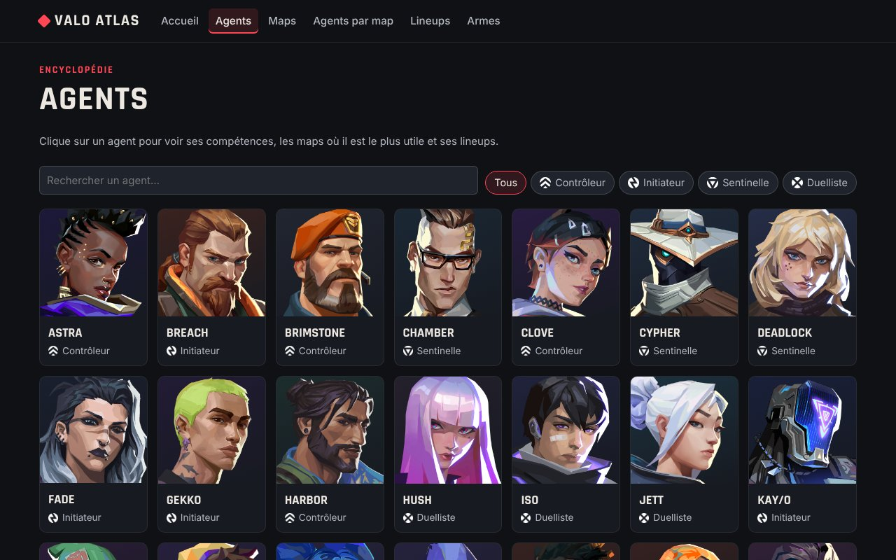
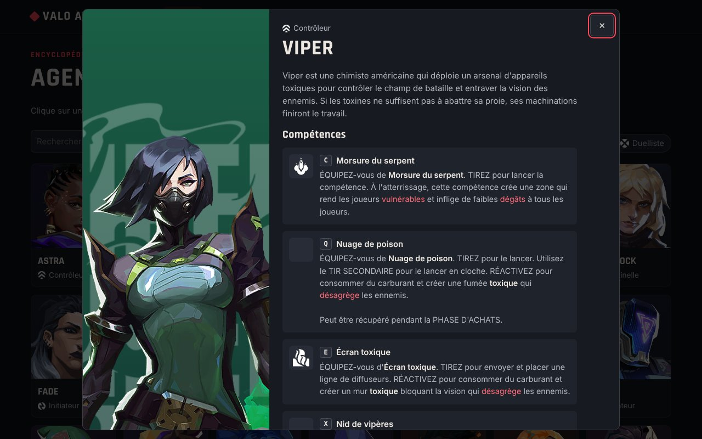
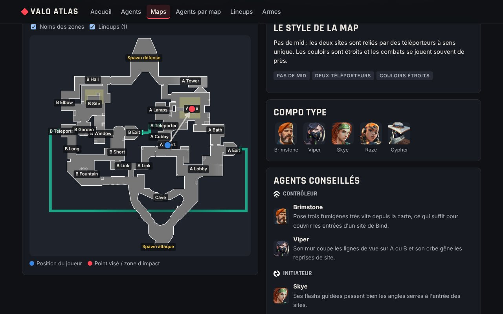
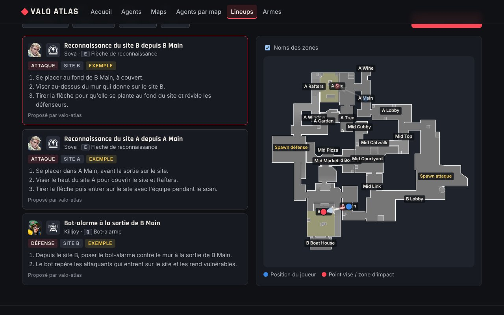
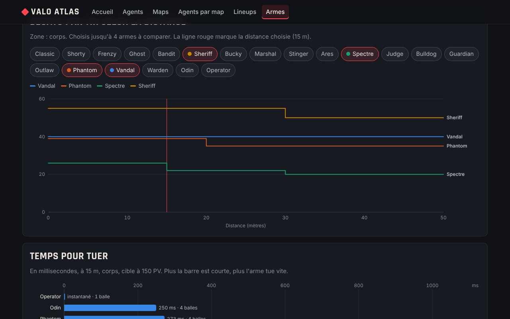

# Valo Atlas

Encyclopédie de fan pour **Valorant** : les agents, les maps, les agents à jouer sur chaque map, une base de lineups ouverte aux contributions et une analyse chiffrée des armes.

**Site en ligne : https://melcoloy.github.io/valorant-guide/**

Le site est fait en HTML, CSS et JavaScript, sans framework ni étape de compilation. Il est hébergé gratuitement sur GitHub Pages.



## Fonctionnalités

| Page | Contenu |
|---|---|
| **Agents** | Tous les agents, filtrables par rôle. Chaque fiche montre les compétences avec leur touche (C, Q, E, X), les maps où l'agent est conseillé et ses lineups. |
| **Maps** | Les maps compétitives, avec la minimap annotée du nom de chaque zone (A Main, Mid Courtyard…), le style de la map, une compo type et les agents conseillés. |
| **Agents par map** | Un tableau maps × rôles, avec au moins deux agents conseillés par rôle sur chaque map et la raison de chaque choix, plus un classement des agents les plus polyvalents. |
| **Lineups** | Une base de lineups filtrable par map, agent, camp et site, affichés en flèches sur la minimap. Un éditeur permet de placer ses propres points et génère l'entrée JSON à ajouter. |
| **Armes** | Dégâts selon la distance, nombre de balles et temps pour tuer (TTK) selon le bouclier de la cible et la zone visée, avec un tableau triable et des graphiques. |

| | |
|---|---|
|  |  |
|  |  |

## Lancer le site sur ton ordinateur

Les pages chargent des fichiers JSON : il faut donc passer par un petit serveur local (ouvrir `index.html` directement par double-clic ne marche pas).

```bash
git clone https://github.com/melcoloy/valorant-guide.git
cd valorant-guide
python -m http.server 8000
```

Ouvre ensuite http://localhost:8000 dans ton navigateur.

Avec VS Code, l'extension **Live Server** fait la même chose en un clic.

## Mettre le site en ligne avec GitHub Pages

1. Pousse le projet sur GitHub.
2. Dans le dépôt : **Settings → Pages**.
3. Dans **Source**, choisis **Deploy from a branch**, puis la branche `main` et le dossier `/ (root)`.
4. Après une ou deux minutes, le site est en ligne à l'adresse `https://melcoloy.github.io/valorant-guide/`.

## Structure du projet

```
valorant-guide/
├── index.html, agents.html, maps.html, meta.html, lineups.html, armes.html
├── assets/
│   ├── css/style.css         # tout le style (couleurs en variables en haut du fichier)
│   └── js/
│       ├── api.js            # récupère et simplifie les données de valorant-api.com
│       ├── calculs-armes.js  # formules de la page Armes (balles pour tuer, TTK, DPS)
│       ├── ui.js             # en-tête, pied de page, fonctions utilitaires
│       ├── minimap.js        # minimap avec noms des zones et flèches de lineup
│       ├── graphiques.js     # graphiques SVG faits maison (sans bibliothèque)
│       └── accueil.js, agents.js, maps.js, meta.js, lineups.js, armes.js   # une page = un fichier
├── data/
│   ├── lineups.json          # la base de lineups (à enrichir !)
│   ├── meta-maps.json        # agents conseillés par map, avec la raison
│   └── api/                  # copie de secours de valorant-api.com
├── scripts/
│   ├── valider_donnees.py    # vérifie les fichiers JSON
│   └── instantane_api.py     # met à jour la copie de secours de data/api/
├── tests/                    # tests des calculs et du repli hors ligne (npm test)
└── .github/workflows/        # lance la vérification et les tests à chaque pull request
```

## D'où viennent les données ?

- **Agents, maps, armes, images** : [valorant-api.com](https://valorant-api.com), une API communautaire gratuite et sans clé. Les textes sont récupérés en français (`language=fr-FR`) et mis en cache 12 h dans le navigateur. Si l'API ne répond pas, le site utilise la copie enregistrée dans `data/api/` et affiche un bandeau pour le signaler. Après un patch (nouvel agent, nouvelle map, équilibrage), mets cette copie à jour avec `python scripts/instantane_api.py`.
- **Lineups et agents conseillés par map** : les fichiers du dossier `data/`, écrits à la main par les contributeurs.

Les positions sur la minimap sont stockées entre 0 et 1 (0 = bord gauche ou haut, 1 = bord droit ou bas). Les noms des zones sont placés avec la formule de conversion fournie par l'API (`xMultiplier`, `xScalarToAdd`…), voir `versMinimap()` dans `assets/js/api.js`.

## Contribuer

Tu connais un bon lineup, ou une recommandation de la page « Agents par map » est dépassée ? Toutes les contributions sont les bienvenues : lis [CONTRIBUTING.md](CONTRIBUTING.md).

Pour vérifier tes modifications avant d'ouvrir une pull request :

```bash
python scripts/valider_donnees.py
```

Si tu modifies le JavaScript, lance aussi les tests (Node.js 22 ou plus, rien à installer) :

```bash
npm test
```

## Idées pour la suite

- Ajouter de vrais lineups testés en jeu (les 4 actuels sont des exemples) avec des vidéos.
- Confirmer en jeu les recommandations de Corrode et Summit (marquées « À confirmer ») et ajouter les agents récents.
- Un générateur de compo aléatoire qui respecte les rôles.
- Un quiz : reconnaître un agent à partir d'une compétence, ou une map à partir de sa minimap.
- Comparer les armes avec le recul et la précision du premier tir (`firstBulletAccuracy` dans l'API).

## Licence et mentions légales

Le code est sous licence [MIT](LICENSE).

Valo Atlas est un projet de fan gratuit et non commercial, réalisé dans le cadre de la politique de Riot Games sur les projets de fans (« Legal Jibber Jabber »). Les images, les noms et les données du jeu appartiennent à Riot Games.

*Valo Atlas isn't endorsed by Riot Games and doesn't reflect the views or opinions of Riot Games or anyone officially involved in producing or managing Riot Games properties. Riot Games, and all associated properties are trademarks or registered trademarks of Riot Games, Inc.*
